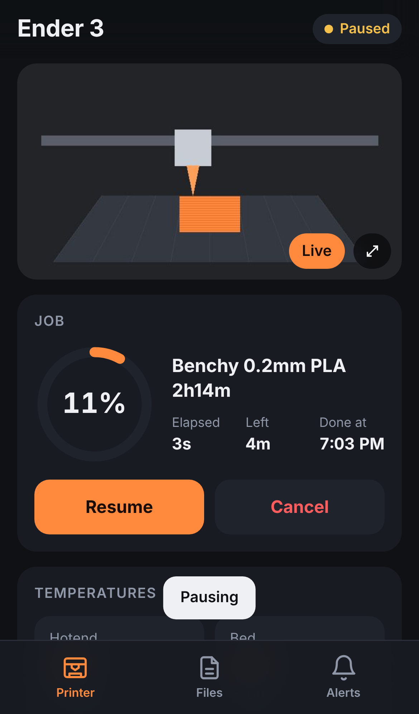
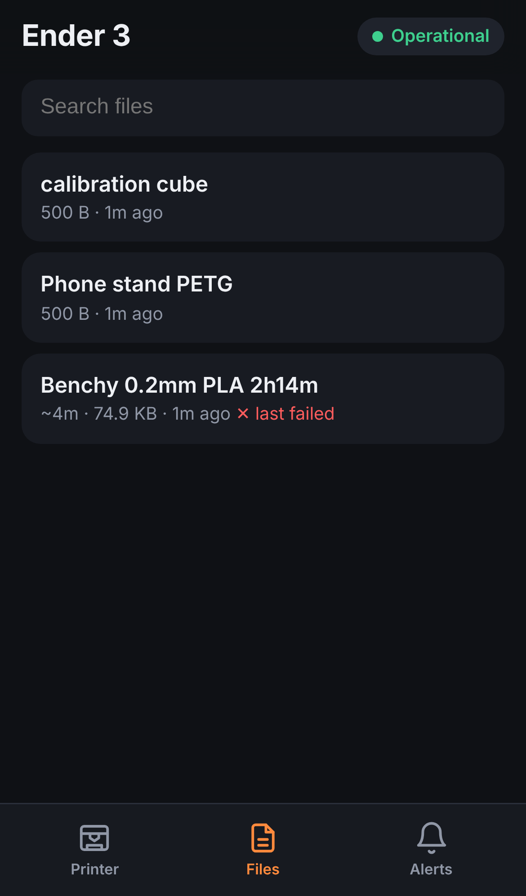
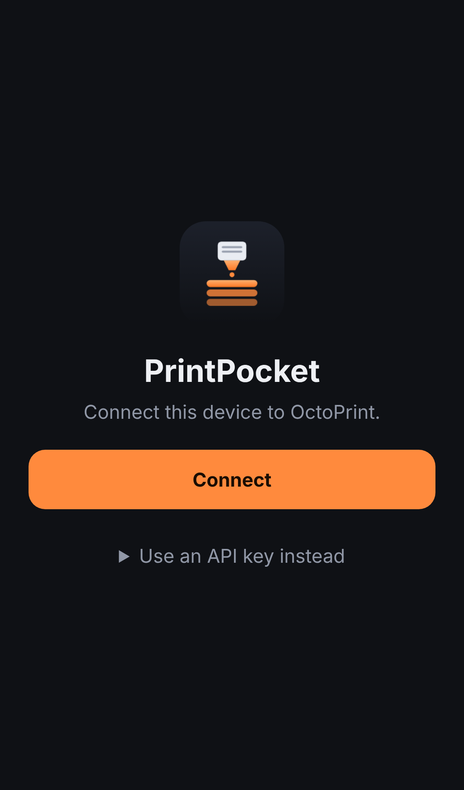

# PrintPocket

A phone app for your OctoPrint printers that you host yourself. No cloud account, no subscription and no AI.

PrintPocket is an OctoPrint plugin. It serves a small, phone-sized web app from your Pi that you add to your home screen. Pair it once with a six-character code and you never type your OctoPrint password on your phone again.

Reach it from anywhere over the VPN you already use (NetBird, Tailscale, WireGuard). Nothing gets exposed to the internet.

<p>
  
  
  
</p>

## What it does

- **Live status.** Shows state, a progress ring, elapsed time, time left, and the clock time the print will finish.
- **Webcam.** Shows a live stream, or a snapshot every 5 seconds to save mobile data. It respects OctoPrint's flip and rotate settings.
- **Controls.** Pause, resume and cancel (cancel asks for confirmation). Tap a temperature to set it, use your OctoPrint preheat presets, or cool down. It can also connect the printer if it's offline.
- **Files.** Search everything on OctoPrint, newest first, with print time estimates and whether the last print of each file worked. Tap a file to print it.
- **Upload from your phone.** Pick a `.gcode` file, for example one a slicer saved to iCloud Drive, and PrintPocket offers to print it right away.
- **Notifications** for print started, finished, failed or cancelled, paused, filament change (M600), progress every N%, and printer errors. There are two ways to get them:
  - **ntfy:** works over any VPN, with no HTTPS needed. Finished, failed and paused notifications include a webcam picture.
  - **Web Push:** goes straight to the PrintPocket icon. Phones only allow this on an `https://` address.

Each Pi gets its own home screen icon, named after the printer.

## How it works

```
 phone ── NetBird / Tailscale ──► OctoPi: OctoPrint + PrintPocket
                                     ├─ app at /plugin/printpocket/
                                     ├─ pairing codes → OctoPrint application keys
                                     ├─ webcam snapshot proxy
                                     └─ notifications ──► ntfy.sh (or your own ntfy) ──► ntfy app on the phone
                                                     └─► Apple / Google push service ──► PrintPocket icon (https only)
```

- The app talks to OctoPrint's own REST API with an **application key**. Each paired phone gets its own key, listed in OctoPrint under Settings, then Application Keys. Delete a key there to cut that phone off.
- Nothing leaves the Pi except the notifications.

## Install

### 1. Install the plugin on each Pi

In OctoPrint, open Settings, then Plugin Manager, then **Get More**. Under **...from URL**, paste the line below, click Install, and restart OctoPrint when it asks.

```
https://github.com/CHANGE_ME/octoonlyhere/archive/main.zip
```

You can also install it over SSH on OctoPi:

```bash
~/oprint/bin/pip install https://github.com/CHANGE_ME/octoonlyhere/archive/main.zip
sudo service octoprint restart
```

### 2. Put the app on your phone

With NetBird running on the Pi and your phone, open this on the phone:

```
http://<pi's NetBird name>/plugin/printpocket/
```

That's usually something like `http://octopi.netbird.cloud/plugin/printpocket/`. You can find the name in the NetBird app's peer list. Its NetBird IP works too.

- **iPhone:** in Safari, tap Share, then **Add to Home Screen**.
- **Android:** in Chrome, open the menu, then **Add to Home screen**.

### 3. Pair the phone

1. In OctoPrint on your computer, go to Settings, then **PrintPocket**, then **Show a pairing code**.
2. Open PrintPocket from the home screen icon and type the code.

The code works once and only for ten minutes. Pair each phone separately.

### 4. Notifications with ntfy

1. Install the free **ntfy** app ([iPhone](https://apps.apple.com/app/ntfy/id1625396347), [Android](https://play.google.com/store/apps/details?id=io.heckel.ntfy)).
2. In OctoPrint, go to Settings, then PrintPocket, click **New topic**, then **Save**.
3. In the ntfy app, tap **+** and subscribe to that same topic. Paste the part after `https://ntfy.sh/`, or the full URL if you use your own ntfy server.
4. Back in OctoPrint, click **Send a test**.

The topic name is long and random, and that's what keeps it private: anyone who knows it could read your printer notifications. If you'd rather not use the public ntfy.sh server, [ntfy is easy to self-host](https://docs.ntfy.sh/install/). Put your server's URL in the topic field and add an access token if your topic is protected.

### Optional: Web Push over HTTPS

If your Pi has an `https://` address that your phone trusts, you can skip the ntfy app. Notifications then arrive on the PrintPocket icon itself: open PrintPocket from that address, go to the Alerts tab, and tap Turn on notifications. On iPhone this needs iOS 16.4 or later and only works from the home screen icon.

Ways to get an HTTPS address:

- **Tailscale:** `sudo tailscale serve --bg 80` does it in one command.
- **NetBird:** its [reverse proxy / `netbird expose`](https://docs.netbird.io/manage/reverse-proxy) gives a service a TLS certificate, but it publishes the service on a public domain. That means your printer would be reachable from the internet. Only do that if you understand what you're exposing.
- **Your own domain:** run Caddy on the Pi with a DNS challenge.

## Settings

In OctoPrint, go to Settings, then PrintPocket:

| Setting | What it does |
|---|---|
| Show a pairing code | Creates a one-time code for pairing a phone |
| Printer name | Used in notifications and the home screen icon. Defaults to OctoPrint's instance name. |
| App address | Where tapping an ntfy notification takes you, for example `http://octopi.netbird.cloud/plugin/printpocket/` |
| Progress every | Step size for progress notifications. 0 turns them off. |
| ntfy topic URL, access token, events, webcam picture | ntfy notifications |
| Push contact | The `mailto:` address included in Web Push requests |

## Troubleshooting

- **The app can't reach OctoPrint away from home.** Check that the NetBird app on the phone is connected and that its access policies allow the phone to reach the Pi.
- **The pairing code doesn't work.** Codes expire after 10 minutes and work once. After 20 wrong codes, pairing locks for 10 minutes.
- **No webcam in the app.** PrintPocket uses the webcams OctoPrint knows about. Check Settings, then Webcam & Timelapse.
- **ntfy test fails.** Check `~/.octoprint/logs/octoprint.log` for lines mentioning ntfy. The Pi needs internet access to reach ntfy.sh.
- **Remove a phone.** In OctoPrint, go to Settings, then Application Keys, and delete its `PrintPocket …` key.

## Development

```bash
python -m venv venv && . venv/bin/activate
pip install octoprint -e . pytest
pytest
octoprint serve --basedir ./devbase   # enable the Virtual Printer plugin, then connect to VIRTUAL
```

The app is plain HTML, CSS and JS in `octoprint_printpocket/static/app/`, with no build step.

## License

AGPLv3, the same as OctoPrint.
